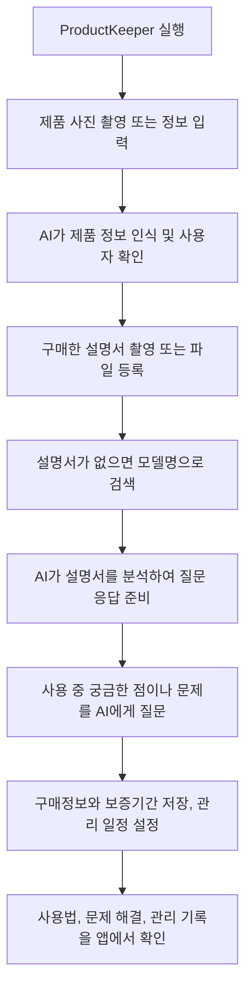

# ProductKeeper 프로젝트 기획서

## 1. 프로젝트 개요

**프로젝트명:** ProductKeeper

**한 줄 소개:** 내가 산 모든 제품의 사용법과 관리 정보를 AI가 찾아주고 관리해주는 제품 관리 앱

**개발 목적**

제품을 구매하면 설명서, 구매 영수증, 보증기간 등 여러 정보를 따로 보관해야 한다. 시간이 지나면 설명서를 잃어버리거나 제품의 사용법을 잊어버리기도 한다.

ProductKeeper는 이러한 문제를 해결하기 위해 제품 정보와 설명서를 한곳에 저장하고, AI를 통해 사용법을 확인하거나 문제 해결 방법을 찾을 수 있도록 돕는다. 또한 구매정보, 보증기간, 제품 관리 일정까지 통합적으로 관리하는 것을 목표로 한다.

## 2. 핵심 기능

### 기능 1. AI 자동 제품 인식 및 등록
사용자가 제품을 사진으로 촬영하면 AI가 제품을 분석하여 정보를 인식한다.

- 브랜드, 제품명, 모델명 인식
- 인식한 제품 정보 확인 및 수정
- 확인한 제품을 개인 제품 목록에 등록
- 등록한 제품의 상세 정보 확인

**이용 예시**

사용자가 새로 구매한 청소기를 촬영하면 AI가 브랜드와 제품 모델을 인식한다. 사용자가 정보를 확인하면 해당 제품이 제품 목록에 등록된다.

> 비슷하게 생긴 제품은 정확하게 구별하지 못할 수 있으므로 사용자가 모델명을 확인하고 수정할 수 있도록 한다.

### 기능 2. 설명서 등록 및 관리
제품을 구매했을 때 받은 설명서를 디지털 형태로 저장하고 제품별로 관리한다.

- 종이 설명서를 카메라로 촬영하여 등록
- PDF 및 이미지 파일 업로드
- 여러 페이지의 설명서를 한 번에 등록
- 등록한 설명서를 해당 제품과 연결
- 제품별 설명서 확인 및 다시 열기

**이용 예시**

사용자가 새 세탁기를 구매하면 설명서를 여러 장 촬영하여 등록한다. 등록된 설명서는 세탁기 정보와 연결되어 나중에도 쉽게 확인할 수 있다.

### 기능 3. AI 설명서 분석 및 사용법 복구
ProductKeeper의 핵심 기능으로, AI가 등록된 설명서의 내용을 분석하여 사용자가 필요한 정보를 쉽게 찾을 수 있도록 한다.

- 설명서에서 필요한 내용 검색
- 자연어 질문을 통한 사용법 확인
- 버튼과 기능의 의미 설명
- 에러 코드 및 표시등의 의미 확인
- 청소 및 관리 방법 안내

**이용 예시**

사용자가 세탁기의 특정 버튼이 어떤 기능인지 궁금하면 AI에게 질문한다.

"이 버튼은 무슨 기능이야?"

AI는 등록된 설명서에서 관련 내용을 찾아 이해하기 쉽게 설명한다. 사용자는 설명서 전체를 읽지 않고도 필요한 정보를 확인할 수 있다.

AI의 답변은 가능한 한 해당 제품의 설명서를 근거로 제공하며, 설명서에서 확인할 수 없는 내용은 확실한 정보처럼 안내하지 않는다.

### 기능 4. 자동 설명서 검색
사용자가 설명서를 등록하지 않았거나 설명서를 분실한 경우 제품 정보를 바탕으로 관련 설명서를 검색한다.

- 브랜드와 모델명을 기반으로 설명서 검색
- 제조사의 공식 설명서를 우선적으로 탐색
- 찾은 설명서의 출처와 링크 제공
- 확인한 설명서를 제품 정보에 연결하여 저장

**이용 예시**

사용자가 예전에 구매한 청소기의 설명서를 분실한 경우 제품의 모델명을 입력한다. 앱은 관련 설명서를 검색하고, 찾을 수 있다면 공식 설명서 링크를 제공한다.

> 모든 제품의 설명서를 반드시 찾을 수 있는 것은 아니다. 검색 결과가 없거나 모델이 불확실하면 사용자가 직접 검색할 수 있도록 안내한다.

### 기능 5. AI 제품 문제 해결
제품에 문제가 생겼을 때 증상을 입력하면 AI가 제품 설명서와 관련 정보를 바탕으로 확인 사항과 해결 방법을 안내한다.

- 고장 증상 입력
- 설명서에 기재된 문제 해결 방법 검색
- 사용자가 직접 확인할 수 있는 기본 점검 방법 안내
- 위험하거나 전문적인 수리가 필요한 경우 서비스센터 안내

**이용 예시**

사용자가 다음과 같이 질문한다.

"청소기가 갑자기 작동하지 않아."

AI는 전원 연결 상태, 충전 상태, 먼지통 장착 여부 등 해당 제품의 설명서에서 확인할 수 있는 점검 항목을 안내한다.

전기적 결함, 과열, 연기 등 위험한 증상이 나타나면 사용을 중단하고 제조사의 공식 서비스센터에 문의하도록 안내한다. AI가 확인되지 않은 원인을 확정하거나 위험한 수리를 지시하지 않도록 한다.

### 기능 6. 구매정보 및 보증기간 관리
제품을 구매했을 때의 정보와 보증기간을 제품별로 저장한다.

- 구매일 및 구매 가격 기록
- 구매처 입력
- 영수증 사진 또는 파일 저장
- 보증기간 및 보증 종료일 입력
- 보증 종료 전 알림 설정

**이용 예시**

사용자가 노트북을 등록하면서 구매일과 가격, 구매처, 보증기간을 입력한다. 이후 앱에서 구매정보를 확인하거나 보증기간이 끝나기 전에 알림을 받을 수 있다.

> 보증기간은 제품과 구매처, 보증 조건에 따라 다를 수 있으므로 사용자가 확인한 내용을 기준으로 관리한다.

### 기능 7. 제품 관리 알림
제품을 오래 사용할 수 있도록 정기적인 관리 일정을 등록하고 알림을 제공한다.

- 필터 교체 및 청소 일정 등록
- 배터리 점검 등 관리 일정 등록
- 제품별 관리 주기 설정
- 관리 예정일 알림
- 완료한 관리 기록 확인

**이용 예시**

사용자가 공기청정기의 필터 교체 주기를 설정하면 교체 예정일에 알림을 받는다. 필터를 교체한 뒤 완료 기록을 남기고 다음 일정을 관리할 수 있다.

관리 주기는 제품 설명서의 권장 사항을 우선적으로 따르며, 제품마다 다른 조건을 적용할 수 있도록 한다.

## 3. 전체 이용 과정

1. 사용자가 ProductKeeper를 실행한다.
2. 제품 사진을 촬영하거나 제품 정보를 입력한다.
3. AI가 제품 정보를 인식하고 사용자가 확인한다.
4. 구매한 설명서를 촬영하거나 파일로 등록한다.
5. 설명서가 없다면 제품 모델명으로 검색한다.
6. AI가 설명서를 분석하여 질문에 답변할 수 있도록 준비한다.
7. 사용 중 궁금한 점이나 문제가 생기면 AI에게 질문한다.
8. 구매정보와 보증기간을 저장하고 관리 일정을 설정한다.
9. 이후 제품 사용법, 문제 해결, 관리 기록을 앱에서 확인한다.

## 4. 핵심 차별점

**첫째, 설명서를 단순히 보관하는 데서 끝나지 않는다.**

저장된 설명서를 AI가 분석하여 사용자가 질문하는 방식으로 필요한 정보를 찾을 수 있도록 한다.

**둘째, 설명서를 직접 등록하거나 자동으로 검색할 수 있다.**

사용자가 구매 당시 받은 설명서를 등록할 수 있으며, 설명서가 없는 경우에는 제품 모델명을 바탕으로 다시 찾을 수 있다.

**셋째, 제품 구매 이후의 관리까지 지원한다.**

구매정보와 보증기간을 저장하고, 필터 교체나 청소 등의 관리 일정을 함께 관리한다.

**넷째, 다양한 종류의 제품을 한곳에서 관리한다.**

가전제품뿐 아니라 전자기기, 생활용품 등 사용법이나 관리정보가 필요한 여러 제품을 등록할 수 있도록 설계한다. 단, 제품별로 인식 정확도와 제공 가능한 정보에는 차이가 있을 수 있다.

## 5. MVP 개발 범위

MVP는 실제로 서비스를 시험할 수 있는 최소 기능 제품을 의미한다. 처음부터 모든 제품을 완벽하게 지원하기보다는 다음 기능을 우선 개발한다.

1. 제품 등록 및 기본 정보 관리
2. 제품 사진과 모델명 입력
3. 설명서 사진 및 PDF 업로드
4. 등록된 설명서 내용 검색과 AI 질문 답변
5. 제품 모델명 기반 설명서 검색
6. 구매정보 및 보증기간 저장
7. 관리 일정 등록과 알림

AI 자동 제품 인식과 고장 문제 해결은 정확도를 검증하면서 단계적으로 개선한다. 특히 AI가 설명서를 근거로 답변하도록 하고, 잘못된 정보가 제공되지 않도록 출처 확인과 오류 처리 기능을 함께 마련한다.

## 6. 기대 효과

- 분실한 설명서를 다시 찾는 시간 절약
- 복잡한 설명서에서 필요한 정보를 빠르게 확인
- 제품 사용법을 잊어버렸을 때 간편하게 복구
- 제품 문제 발생 시 기본 점검 방법 확인
- 구매정보와 보증기간을 체계적으로 관리
- 정기적인 제품 관리로 유지관리 편의성 향상

## 7. 최종 목표

ProductKeeper는 사용자가 구매한 제품의 정보를 기억하고 관리해주는 개인 제품 관리 플랫폼을 목표로 한다.

제품 등록부터 설명서 보관, AI 사용법 복구, 문제 해결, 구매정보 관리, 보증기간 확인, 정기 관리 알림까지 하나의 앱에서 제공하여 제품을 구매한 순간부터 사용하는 기간 전체를 지원한다.
